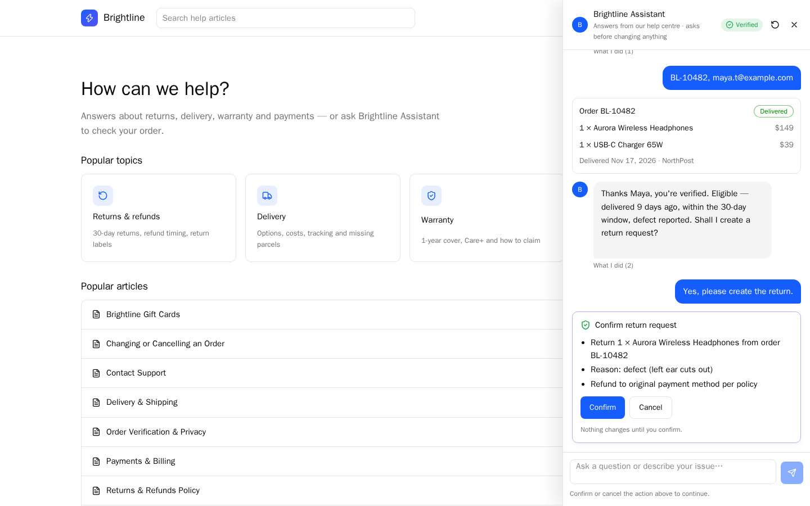
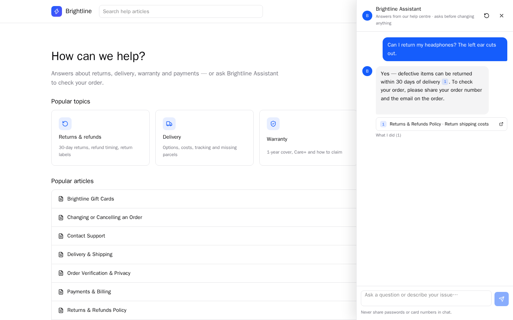
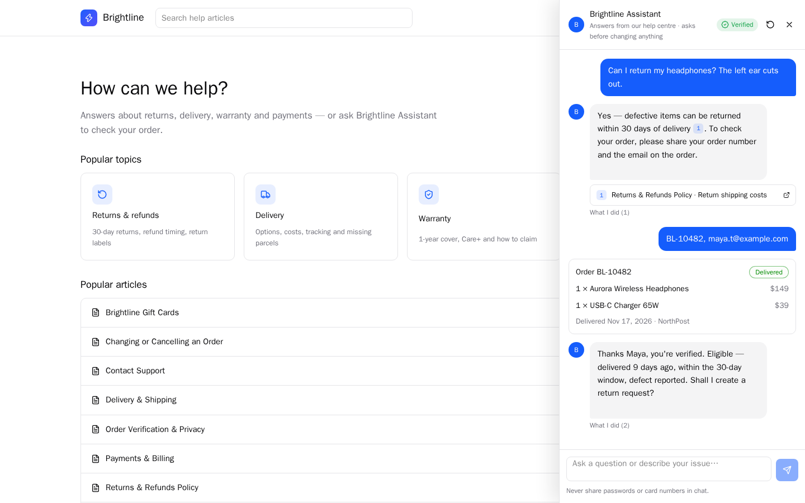
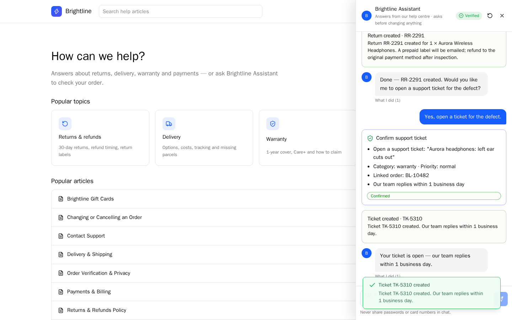
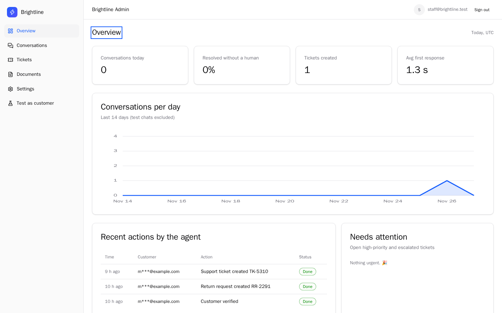
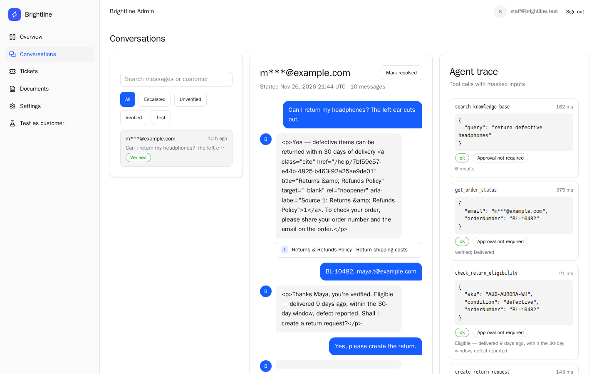
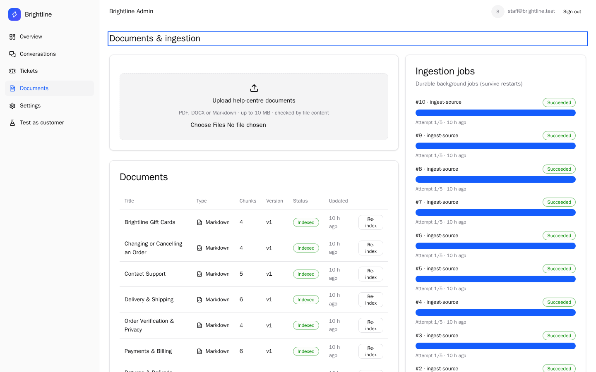
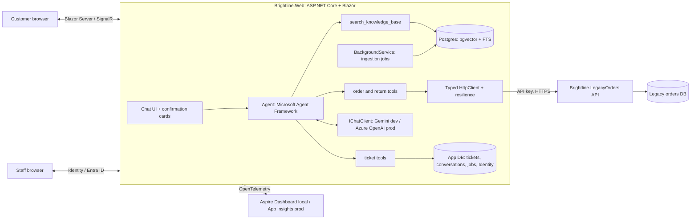
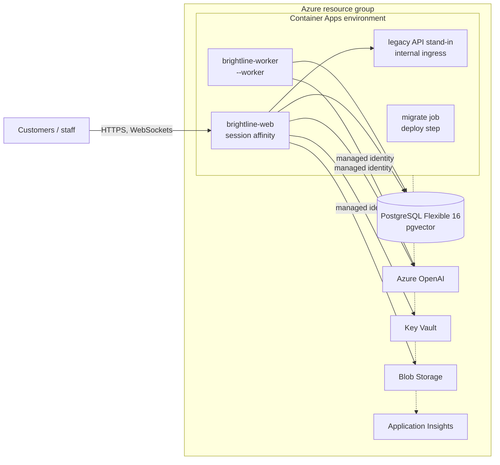

# Brightline AI Support Agent (.NET 10)

<!-- Demo GIF: record with `make dev` and save as docs/images/demo.gif, then replace this screenshot (docs/PROGRESS.md). -->

**Add an AI agent to your existing .NET systems: it answers from your documents and safely acts through your current APIs — for companies that want AI customer support without a rewrite or moving data out of their Azure tenant.**

[Live demo](#live-demo) · [2-min video](#live-demo) · [Architecture](docs/architecture.md) · [Evaluation](eval/results.md) · [Decisions](docs/DECISIONS.md)

## What it does

Brightline Electronics is a fictional online retailer with an **existing Orders & Returns API**. This repo adds:

- **Customer chat (Blazor)** – streaming answers from the help centre with **numbered citations** bound to the retrieved
  passages; "I don't know" plus a ticket offer when the documents don't cover a question.
- **An agent that acts through the existing API** (Microsoft Agent Framework, 7 typed tools): order status, my orders,
  return eligibility (with the reason), **return requests** and **support tickets** – each change shown as a
  **confirmation card**; nothing happens until the customer clicks *Confirm*.
- **Verification and privacy** – order tools need the order number **and** the email on that order; the verified
  customer id lives on the server, never in the model's arguments; personal data is masked in logs, traces and the audit trail.
- **Admin console** – overview, conversations with the full agent trace (masked inputs, approvals, latency, tokens,
  cost), tickets, documents and durable ingestion jobs, settings (prompt, policy values, model), "Test as customer".
- **Production profile** – Azure Container Apps + PostgreSQL Flexible (pgvector) + Azure OpenAI + Key Vault + managed
  identity + Application Insights in Bicep, validated in CI.

The demo story: Maya's Aurora headphones (order BL-10482, delivered 9 days ago) lose sound on the left side. She asks
the assistant, verifies with her order number and email, sees "Eligible — delivered 9 days ago, within 30-day window,
defect reported", confirms, and gets return **RR-2291** and ticket **TK-5310**.

## Screens

| | |
|---|---|
|  |  |
|  |  |
|  |  |

Screenshots are produced by the end-to-end test (`make screenshots`) with a scripted model, so they are reproducible.

## Results

Two kinds of evidence, both reproducible:

**Deterministic checks (every commit, no API key):** `make check` runs 100+ unit, integration (real Postgres via
Testcontainers) and bUnit tests; `make e2e` drives the full story in Chromium (chat → verify → return with
confirmation → staff sees the ticket). These prove the safety rules structurally: forged customer ids are ignored,
writes can't run without approval, cancelling cancels, retries don't duplicate, the app never touches the legacy database.

**Model quality (`make eval`, needs a Gemini key):** the numbers below are generated by `tests/Brightline.Eval` into
[`eval/results.md`](eval/results.md) / `results.json`.

| Metric | Result | Target |
|---|---|---|
| Groundedness · relevance · completeness (40 questions, AI.Evaluation, 1–5) | _run `make eval`_ | ≥ 4 |
| Citation validity | _run `make eval`_ | 100% |
| "I don't know" on 8 unanswerable questions | _run `make eval`_ | 100% |
| Agent scenarios passed (25) | _run `make eval`_ | 25/25 |
| Verification enforced on order tools · approvals before writes | _run `make eval`_ | 100% · 100% |
| Cross-customer leaks · duplicate writes | _run `make eval`_ | 0 · 0 |
| Time to first token p50 / p95 | _run `make eval`_ | – |
| Tokens and est. Azure OpenAI cost per conversation | _run `make eval`_ | – |

## Architecture

More detail (project layout, tool contracts, data model): [docs/architecture.md](docs/architecture.md).

## Stack & why

| Component | Choice | Why |
|---|---|---|
| Runtime | .NET 10 LTS, C#, nullable + warnings as errors | Long-term support; clients run it in production. |
| Web | ASP.NET Core + Blazor Web App (Interactive Server) + NeoUI.Blazor (MIT, shadcn/ui look) | One deployable, all C# – an existing .NET team can maintain it. |
| Agent | Microsoft Agent Framework 1.28 on Microsoft.Extensions.AI | GA successor to Semantic Kernel: function tools, tool approval, streaming, OpenTelemetry. |
| LLM | Gemini Flash via the OpenAI .NET SDK (dev/demo) · Azure OpenAI with managed identity (prod) | $0 development; production data stays in the client's tenant; one config switch. |
| Retrieval | Postgres + pgvector (CommunityToolkit.VectorData.PgVector) + full-text, merged with RRF | One database, works on Neon and Azure Database for PostgreSQL. |
| Data | EF Core + migrations (Npgsql) | Standard for .NET teams; versioned schema. |
| Legacy API | Typed HttpClient + Microsoft.Extensions.Http.Resilience | The standard way to call existing services: retries, timeouts, circuit breaker. |
| Jobs | BackgroundService + Postgres jobs table (`SKIP LOCKED`, backoff, dead-letter) | Durable ingestion with no extra infrastructure. |
| Auth | ASP.NET Core Identity (admin/staff) + optional Entra ID | Built in; Azure customers expect Entra ID. |
| Observability | OpenTelemetry → Aspire Dashboard (local) / Application Insights (prod) | Every agent step, tool call and LLM call traced. |
| Tests | xUnit v3, Testcontainers, bUnit, Playwright for .NET, Microsoft.Extensions.AI.Evaluation | The standard .NET stack plus Microsoft's AI evaluation libraries. |

Every decision with its alternative: [docs/DECISIONS.md](docs/DECISIONS.md).

## Quick start

1. `cp .env.example .env` and set `Ai__Gemini__ApiKey` ([get a free key](https://aistudio.google.com/apikey)).
2. `make dev` (= `docker compose up --build`): app, legacy API, Postgres + pgvector, Aspire Dashboard. Help-centre
   documents and legacy orders are seeded on first start.
3. Open <http://localhost:5080> and ask: *"Can I return headphones if one side stopped working?"* — then give
   `BL-10482` and `maya.t@example.com`.

Staff console: `make create-admin EMAIL=you@example.com` (prints a one-time password) → <http://localhost:5080/admin>.
Traces: <http://localhost:18888>. Legacy API docs: <http://localhost:5081/scalar>.

No local .NET SDK or make? Every target also runs in a container: `./scripts/dev.sh make check` (or `scripts/dev.ps1`).
Without an AI key the app still starts: articles and keyword search work, and the chat says the assistant isn't configured.

## Configuration

All settings are in [.env.example](.env.example) with comments and where to get each key. Key switches:
`Ai__Provider` (`gemini-openai-compat` | `azure-openai` | `openai`), `Ai__ChatModel`, `Ai__EmbeddingModel`
(`Ai__EmbeddingDimensions=768` must match the `vector(768)` column), `Auth__EntraId__*`, `Demo__*`, `RateLimit__ChatPerMinute`,
`Worker__Mode` (`embedded` | `separate`).

## Evaluation

`make eval` (with `make dev` running) asks 40 help-centre questions and 8 unanswerable ones through the real agent, scores
them with Microsoft.Extensions.AI.Evaluation (groundedness against the cited passages, relevance, completeness against
reference answers – judge responses cached), and runs 25 scripted agent conversations whose assertions read the app
database and the legacy API (reset before each scenario). Details: [eval/README.md](eval/README.md).

## Costs

- **Development: $0** – .NET and all packages are free; Gemini Flash + embeddings on the free tier; Postgres and the
  Aspire Dashboard run locally; the demo runs on Render free + Neon free. Free-tier limits: Gemini requests per minute/day
  (the app throttles with `Ai__MaxRequestsPerMinute`), Render services sleep when idle, Neon free storage limits.
- **Per conversation (production, Azure OpenAI `gpt-4.1-mini` list price $0.40 / $1.60 per 1M tokens):** a typical
  support conversation uses ~6k input and ~600 output tokens ≈ **$0.0034**; `make eval` measures the real figure.

## Production deployment

Bicep: [deploy/azure/main.bicep](deploy/azure/main.bicep) – validated in CI (`az bicep build` + lint); the deploy
workflow (`.github/workflows/deploy-azure.yml`) runs on a release tag only when `AZURE_DEPLOY_ENABLED=true`.

**Estimated monthly cost (USD, list prices, East US; check the Azure pricing calculator):**

| Item | 1,000 conversations / month | 10,000 conversations / month |
|---|---|---|
| Container Apps: web (1 vCPU, 2 GiB, 1–2 replicas) + worker (0.5 vCPU) | ~$110 | ~$150 |
| PostgreSQL Flexible Server B2s + 32 GB | ~$55 | ~$55 |
| Azure OpenAI (≈ $0.0034 / conversation) | ~$4 | ~$35 |
| Application Insights / Log Analytics | ~$10 | ~$25 |
| Key Vault, Blob Storage, egress | ~$3 | ~$5 |
| **Total** (excl. the client's own legacy system) | **≈ $180** | **≈ $270** |

**Scaling:** Blazor Server keeps a circuit per user, so the web app scales out with **session affinity** (sticky) and
WebSockets; Data Protection keys live in Postgres so cookies work on every replica. Ingestion runs in the separate
worker (`Worker__Mode=separate`), claiming jobs with `SKIP LOCKED`, so more workers can be added safely. For very large
document sets, Azure AI Search can replace pgvector behind the same search interface.

**Security summary:** Entra ID (optional) or Identity with admin/staff roles, antiforgery and login rate limiting; no
public sign-up. Managed identity for Azure OpenAI (local auth disabled), Key Vault, Blob Storage – no secrets in app
settings. CSP and security headers, HSTS, HTTPS only. Server-side verification, approval-gated writes with business rules
re-checked on the server, idempotency keys, prompt-injection-safe handling of documents and API data, PII masking.
Non-root containers, pinned images, Dependabot, CodeQL and Trivy in CI. Migrations run as a deploy job, never at start-up.

## Live demo

The demo runs on Render (two Docker services) + Neon in demo mode: 40 conversations per day, per-IP rate limits,
nightly reset of order data, and a read-only staff account. Setup guide: [docs/deploy-render-neon.md](docs/deploy-render-neon.md).
_Link and demo staff credentials are added here after deployment (see docs/PROGRESS.md)._

## Limitations & next steps

- Microsoft Teams and other channels (the agent and tools are channel-independent; next step).
- Uploads are stored in Postgres for the demo (10 MB limit); the production profile provisions Blob Storage for them.
- A Blazor circuit that is lost (e.g. a server restart) starts a new chat; the transcript is kept for staff.
- Single company per deployment (not multi-tenant). Refunds stay in the legacy system's own process.
- UI follows the Stitch design brief (`docs/ui/STITCH_PROMPT.md`); exported Stitch screens can be added to `docs/ui/`.

## License

[MIT](LICENSE)
