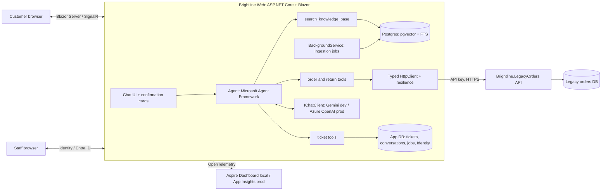

# SPEC – AI Inside .NET: Support Agent for Existing Business Systems
**Repo:** `dotnet-ai-support-agent` · **Priority:** 6 · **Follows:** `docs/CONVENTIONS.md` (with the .NET overrides in section 4a)

## 1. Goal
An ASP.NET Core (.NET 10) application that adds an AI support agent to a company's **existing** systems. Customers chat with it. It answers from company documents with citations (RAG) and **takes real actions through the company's existing business services**: looking up orders, checking return eligibility, creating return requests and support tickets. Any action that changes data needs explicit confirmation. Staff get an admin console for documents, conversations, tickets and settings.

**One-line value statement:** "Add an AI agent to your existing .NET systems: it answers from your documents and safely acts through your current APIs."

**Demo company:** "Brightline Electronics", a fictional online electronics retailer. It has an existing "Orders & Returns" REST API (a separate project in the repo, representing a legacy system the agent must not modify) and a help-centre document set.

## 2. Who it's for and the problem
Companies with existing .NET systems that want AI without rewriting anything or moving data out of their Azure tenant. Few freelancers offer .NET plus modern AI, so this repo is the proof.

## 3. Scope
### In scope (MVP)
1. **Customer chat (Blazor):**
   - Streaming answers with numbered citations bound to retrieved chunks, as in Project 2: the server maps numbers to stored sources and drops any invalid ones.
   - "I don't know" plus an offer to create a ticket when the documents don't cover the question.
2. **Agent tools** (Microsoft Agent Framework function tools, each with typed inputs and validation):

   | Tool | Type | Calls | Rule |
   |---|---|---|---|
   | `search_knowledge_base` | read | internal RAG | Always used for policy and how-to questions. |
   | `get_order_status` | read | Legacy Orders API | Requires order number **and** matching email (customer verification). |
   | `list_my_orders` | read | Legacy Orders API | Only after verification in this conversation. |
   | `check_return_eligibility` | read | Legacy Orders API + return policy | Explains the reason (days since delivery, item category). |
   | `create_return_request` | **write** | Legacy Orders API | **Approval required:** the UI shows a confirmation card; nothing happens until the customer clicks Confirm. Idempotency key per conversation + order line. |
   | `create_support_ticket` | **write** | Helpdesk (app database) | **Approval required.** Ticket gets the conversation summary, category and priority. |
   | `escalate_to_human` | write | Helpdesk | Creates a high-priority ticket and tells the customer the expected response time. |

3. **Verification and privacy:**
   - Order tools only work after the customer gives an order number plus the email on that order. The verified customer ID is held server-side in the conversation, never taken from the model's arguments.
   - The agent can never see or return another customer's data.
   - Personal data is masked in logs and traces.
4. **Knowledge base and ingestion:**
   - PDF, DOCX and Markdown upload in the admin console.
   - Chunking, embedding and storage in pgvector.
   - Hybrid search: vector plus Postgres full-text, merged with RRF.
   - Safe re-indexing: the new version is swapped in atomically.
   - Ingestion runs as a durable background job (`BackgroundService` + Postgres jobs table with `SKIP LOCKED`).
5. **Admin console (Blazor, role `staff` / `admin`):**
   - Documents and ingestion jobs.
   - Conversations: transcript, citations, tool calls with inputs and outputs (masked), approvals, token usage.
   - Tickets: list, detail, status changes.
   - Settings: system prompt, return policy values, model, approval rules.
   - "Test as customer" mode.
6. **Legacy Orders & Returns API (separate project, `src/Brightline.LegacyOrders`):**
   - A minimal REST API with its own database schema and seed data: customers, orders, order lines, deliveries, returns.
   - Secured with an API key; OpenAPI documented.
   - It stands in for an existing system: the agent app reaches it **only over HTTP through a typed client**, never through its database.
7. **Evaluation:**
   - Microsoft.Extensions.AI.Evaluation quality evaluators (groundedness, relevance, completeness) on 40 questions.
   - Plus 25 tool scenarios checking: correct tool chosen, verification enforced, approval required before writes, no cross-customer leakage, idempotent writes.
   - Latency (time to first token) and tokens per conversation.

### Out of scope
- Voice and phone channels (covered by the voice project).
- Multi-tenant SaaS: single company per deployment.
- Real payment or refund execution: a return request is created, and refunds stay in the legacy system's own process.
- Fine-tuning.
- Microsoft Teams or other channel integrations. Note as a next step.

## 4. Stack (decided)
| Component | Choice | Why |
|---|---|---|
| Runtime | **.NET 10 (LTS)**, C#, nullable reference types on, warnings as errors | Long-term support version, which clients want for production. |
| Web app | **ASP.NET Core + Blazor Web App (Interactive Server)** | One deployable app for customer chat and admin console. All C#, so an existing .NET team can maintain it. |
| Agent framework | **Microsoft Agent Framework 1.0** (`Microsoft.Agents.AI`) on **Microsoft.Extensions.AI** (`IChatClient`) | Microsoft's GA successor to Semantic Kernel. Function tools, tool approval, streaming, OpenTelemetry. Provider-agnostic through `IChatClient`. |
| LLM (development and demo) | **Gemini Flash (free tier)** through the **OpenAI .NET SDK** pointed at Gemini's OpenAI-compatible endpoint | $0 development with no extra SDK. The provider is chosen by config (`Ai:Provider`). The compatibility endpoint may not support every feature: if a needed feature breaks, record it in `DECISIONS.md` and use the Gemini REST API behind the same `IChatClient`. |
| LLM (production) | **Azure OpenAI** (`Ai:Provider=azure-openai`, managed identity) | Data stays in the client's Azure tenant. A config switch, not a code change. |
| Embeddings | Gemini embeddings (development) or Azure OpenAI embeddings (production), through `IEmbeddingGenerator` | Same abstraction, swapped by config. |
| Vector + keyword search | **PostgreSQL + pgvector** through **`CommunityToolkit.VectorData.PgVector`** (Microsoft.Extensions.VectorData, v1 stable) + Postgres full-text search | Standard .NET vector abstraction, one database, works with Neon and Azure Database for PostgreSQL. |
| Data access | **EF Core** (Npgsql) with **EF Core migrations** | Standard for .NET teams. Versioned schema. |
| Auth | **ASP.NET Core Identity** (staff/admin, roles); optional **Microsoft Entra ID (OIDC)** sign-in by config for production | Built-in, production-grade. Companies on Azure expect Entra ID. |
| Customer access | Anonymous chat session + in-chat verification (order number + email) | Customers don't need an account to get help. Verification guards all personal data. |
| Calling the legacy API | Typed `HttpClient` + **Microsoft.Extensions.Http.Resilience** (retries, timeout, circuit breaker) | The standard .NET way to call existing services reliably. |
| UI components | **NeoUI.Blazor** (shadcn/ui design + Tailwind) | Same look as the other portfolio repos. **M0 must confirm its license is open source and permits commercial use.** If not, fall back to another shadcn-style Blazor library (Blazor Blueprint, Lumeo) or Microsoft Fluent UI Blazor, and record the choice in `DECISIONS.md`. |
| Background jobs | `BackgroundService` + Postgres jobs table (`SKIP LOCKED`, retries, dead-letter) | Durable ingestion with no extra infrastructure. The same pattern as the Python repos. |
| Observability | **OpenTelemetry** (built into .NET and Agent Framework). Locally: the standalone **Aspire Dashboard** container in docker compose. Production: Azure Monitor / Application Insights exporter | Traces of every agent step and tool call, plus logs and metrics, using the .NET-native tooling. |
| Tests | **xUnit**, **Testcontainers** (real Postgres), **bUnit** (Blazor components), **Playwright for .NET** (end-to-end), **Microsoft.Extensions.AI.Evaluation** (prompt and agent quality) | The standard .NET testing stack, plus Microsoft's own AI evaluation libraries. |
| Local development | `docker compose up`: web app, legacy API, Postgres + pgvector, Aspire Dashboard | One-command setup, per CONVENTIONS. |
| Live demo | **Render** (two Docker web services: app + legacy API) + **Neon** (two databases) | Free. Blazor Server works over WebSockets on Render. Cold starts are expected. |
| Production profile | **Azure Container Apps** (app + legacy API stand-in) + **Azure Database for PostgreSQL Flexible Server** (pgvector) + **Azure OpenAI** + **Key Vault** + **managed identity** + **Application Insights**, in **Bicep** under `deploy/azure/` | What a client on Azure would run. Validated in CI, not deployed. Azure AI Search is noted as an option for very large document sets. |

**Not used, on purpose:**
- Semantic Kernel: superseded by Agent Framework.
- Azure AI Search in the demo: Postgres covers it at $0 with one database.
- React: the whole app stays in C# for .NET teams.
- MediatR, AutoMapper and other layers that add no client value.
- Redis.
- .NET Aspire AppHost: docker compose meets the one-command rule. Only the standalone dashboard is used.

## 4a. CONVENTIONS overrides for .NET
| CONVENTIONS default (Python) | This repo |
|---|---|
| `uv`, `pyproject.toml`, `.python-version` | `global.json` (pinned SDK), `Directory.Packages.props` (central package versions), NuGet lock files |
| ruff / mypy | `dotnet format`, .NET analyzers, nullable reference types, `TreatWarningsAsErrors` |
| pytest / Playwright (TS) | xUnit / Testcontainers / bUnit / Playwright for .NET |
| Alembic | EF Core migrations, applied by a migration step on deploy (not at app start-up in production) |
| Argon2 sessions | ASP.NET Core Identity (PBKDF2 by default, per Microsoft guidance), cookie auth with antiforgery |
| `app/llm.py` | `Brightline.Ai` project: `IChatClient` / `IEmbeddingGenerator` registration per `Ai:Provider` |
| Makefile | Still the entry point (`make setup/dev/test/lint/check/eval/seed`), wrapping `dotnet` and `docker compose` |

**Extra production items for .NET:**
- Data Protection keys persisted to the database, which is required for Identity cookies across multiple instances.
- ASP.NET Core rate limiting middleware on the chat endpoints.
- Health checks: `/health` and `/ready`.
- Security headers and CSP.
- HTTPS redirection and HSTS.

## 5. Architecture

**Solution layout (`src/`):**
- `Brightline.Web`: Blazor app, endpoints.
- `Brightline.Agent`: agent definition, tools, prompts.
- `Brightline.Ai`: provider registration.
- `Brightline.Knowledge`: ingestion, retrieval.
- `Brightline.Data`: EF Core context, migrations.
- `Brightline.LegacyOrders`: separate API.
- `Brightline.LegacyOrders.Client`: typed client.

**Tests (`tests/`):**
- Unit, Integration (Testcontainers), Components (bUnit), E2E (Playwright), Eval (AI.Evaluation).

## 6. Data model (app database)
- **Identity tables:** users and roles (`admin`, `staff`).
- **Source:** id, type, title, uri, content_hash, active_version, chunk_count.
- **Chunk:** source_id, version, text, heading_path, page, embedding, tsv.
- **Job:** kind, status, progress, error, lease_until, attempts.
- **Conversation:** id, started_at, verified_customer_id (nullable), status, summary, tokens_in, tokens_out.
- **Message:** conversation_id, role, text, citations, ttft_ms.
- **ToolCall:** conversation_id, tool, args (masked), result_status, approval (`not_required | pending | approved | denied`), idempotency_key, latency_ms.
- **Ticket:** id, conversation_id, category, priority, status, subject, summary, created_at.
- **Setting:** key, value.
- **Legacy database (separate):** customers, orders, order_lines, deliveries, returns. Seeded with about 50 customers and 150 orders.

## 7. Key rules
- **Approval:** write tools use Agent Framework's tool-approval support. The UI renders a confirmation card with exactly what will happen, for example "Create return for 1 × Wireless Headphones (order BL-10482). Refund to original payment method per policy." Denying it cancels the call, and the agent acknowledges.
- **Verification state lives on the server.** Tools read the verified customer ID from the conversation, never from model arguments. A unit test proves a forged customer ID argument is ignored.
- **Prompt injection:** retrieved documents and API responses are wrapped as untrusted data. The system prompt forbids following instructions inside them. Write tools also re-check business rules on the server: return window, item eligibility, quantity.
- **Demo mode:**
  - Daily conversation cap (`Demo:DailyConversations`, default 40) to stay within free tiers.
  - Legacy data reset nightly.
  - Public sign-up for the admin console disabled. Demo staff credentials are given in the README, read-only for settings.

## 8. Evaluation
- **Quality:**
  - 40 questions over the help-centre documents, with reference answers.
  - Scored with Microsoft.Extensions.AI.Evaluation quality evaluators (groundedness, relevance, completeness), results cached with its reporting storage.
  - Plus citation validity, which must be 100%.
  - Plus "I don't know" accuracy on 8 unanswerable questions.
- **Agent scenarios:** 25 scripted conversations in `tests/Eval/Scenarios`, each with assertions on the database and legacy API state:
  - Correct tool selection.
  - Verification enforced on 100% of order tools.
  - Approval requested before 100% of writes.
  - 0 cross-customer leaks.
  - 0 duplicate return or ticket creations on retry.
- **Performance:** p50/p95 time to first token, tokens per conversation, and the estimated Azure OpenAI cost per conversation.
- **Free-tier handling:** the judge model is Gemini Flash (free tier), throttled and cached.
- **Output:** `eval/results.md` and `eval/results.json`, committed.

## 9. Acceptance criteria
- [ ] `make setup && make dev` (docker compose) starts the app, the legacy API, Postgres and the Aspire Dashboard. `make seed` loads the documents and legacy data. A customer can chat within 5 minutes of cloning.
- [ ] Policy questions are answered with valid citations, and unanswerable ones get "I don't know" plus a ticket offer.
- [ ] Order tools refuse without verification. With a correct order number and email, the status, order list and return eligibility are correct against the legacy API.
- [ ] `create_return_request` and `create_support_ticket` show a confirmation card and only run after Confirm. Deny cancels. Retrying doesn't duplicate.
- [ ] The legacy API is reached only through the typed client, over HTTP. A test fails if the app references the legacy database.
- [ ] With the legacy API stopped, the resilience policy retries and then breaks the circuit, and the agent tells the customer it can't reach orders right now and offers a ticket.
- [ ] The admin console shows conversations with tool calls, approvals and token usage. Ingestion jobs are visible and survive a restart.
- [ ] Traces for each conversation (agent steps, tool calls, LLM calls) are visible in the Aspire Dashboard locally.
- [ ] `make eval` reproduces the README numbers, with 100% verification enforcement, 100% approvals before writes, 0 leaks and 0 duplicates.
- [ ] Switching `Ai:Provider` between `gemini-openai-compat` and `azure-openai` needs no code change, covered by a configuration test.
- [ ] **Production readiness** (CONVENTIONS section 10 + section 4a):
  - EF migrations.
  - Data Protection keys persisted.
  - Rate limiting.
  - Health checks.
  - Security headers.
  - Secrets from Key Vault in production.
  - Optional Entra ID sign-in.
  - Playwright end-to-end test: chat → verify → return request with confirmation → staff sees the ticket.
  - Dependabot, CodeQL, image scan.
  - `deploy/azure/` Bicep validates in CI, with a disabled-by-default deploy workflow.
  - README "Production deployment" section with a monthly cost estimate at 1,000 and 10,000 conversations a month.
- [ ] UI matches `docs/ui/`, using NeoUI.Blazor or the recorded fallback.
- [ ] Development MCP servers: `neon` only at the deploy step (shadcn's MCP targets React, so it isn't used here).
- [ ] `AGENTS.md` "Gotchas" lists:
  - Verification state is server-side only.
  - Approval-required tools.
  - The legacy API boundary (HTTP only).
  - Gemini compatibility-endpoint limits and the provider switch.
  - pgvector dimension must match the embedding model.
  - Blazor Server needs WebSockets and sticky sessions behind load balancers.
  - Data Protection keys.
  - Render cold starts.
- [ ] Everything in CONVENTIONS section 8 is done, including the AI-tool handoff check in section 3a.

## 10. Configuration (`appsettings` + environment variables)
`Ai__Provider` (`gemini-openai-compat | azure-openai | openai`), `Ai__ChatModel`, `Ai__EmbeddingModel`, `Ai__EmbeddingDimensions=768`, `Ai__Gemini__ApiKey`, `Ai__Gemini__BaseUrl=https://generativelanguage.googleapis.com/v1beta/openai/`, `Ai__AzureOpenAI__Endpoint`, `ConnectionStrings__App`, `ConnectionStrings__LegacyOrders` (legacy API only), `LegacyOrders__BaseUrl`, `LegacyOrders__ApiKey`, `Auth__EntraId__Enabled=false`, `Auth__EntraId__TenantId`, `Auth__EntraId__ClientId`, `Demo__Enabled`, `Demo__DailyConversations=40`, `RateLimit__ChatPerMinute`, `OTEL_EXPORTER_OTLP_ENDPOINT`, `APPLICATIONINSIGHTS_CONNECTION_STRING` (production).

## 11. Expected development cost
**$0.**
- .NET 10 SDK and all NuGet packages listed: free.
- Gemini Flash and embeddings: free tier.
- Postgres + pgvector and the Aspire Dashboard: local Docker.
- Demo on the Render free and Neon free plans.
- The Azure production profile is only validated, never deployed.

## 12. Upwork case study inputs
- **Problem:** companies with existing .NET systems want AI support without a rewrite.
- **Solution:** an Agent Framework agent with RAG and tool calls through the existing APIs, with confirmation before changes.
- **Result:** "Groundedness X on 40 questions; 25/25 agent scenarios with 100% verification and approval enforcement and 0 data leaks; p95 first token N s; one config switch from Gemini to Azure OpenAI."
