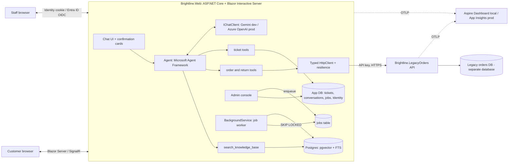
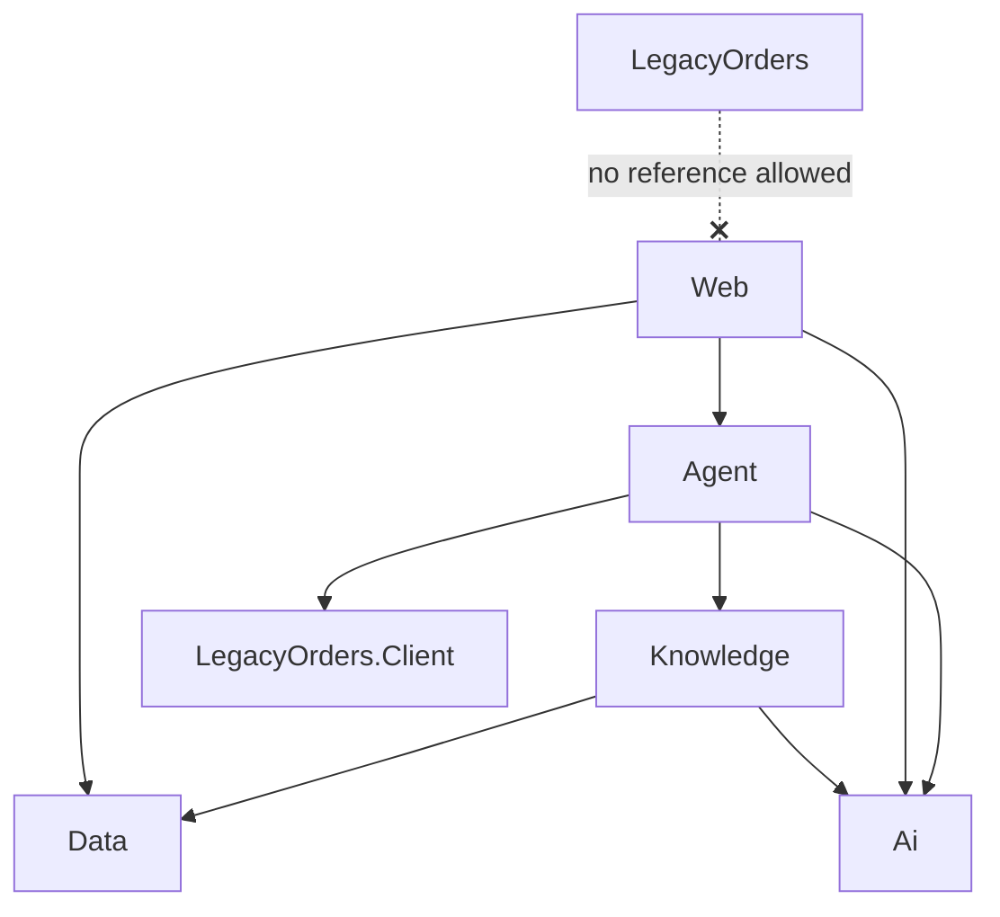

# Architecture – Brightline AI Support Agent

An ASP.NET Core (.NET 10) Blazor app that adds an AI support agent to Brightline Electronics' **existing** systems.
The agent answers from help-centre documents with citations and acts through the existing Orders & Returns API.
Every write needs the customer's explicit confirmation.

## System diagram



## Solution layout

```
Brightline.slnx
global.json                      pinned SDK
Directory.Build.props            net10.0, nullable, analyzers, warnings as errors, lock files
Directory.Packages.props         central package versions
src/
  Brightline.Web                 Blazor Web App (Interactive Server): customer chat, admin console, endpoints, auth, health
  Brightline.Agent               Agent definition, the 7 tools, prompts, conversation state, approval handling
  Brightline.Ai                  IChatClient / IEmbeddingGenerator registration per Ai:Provider
  Brightline.Knowledge           Parsers (PDF/DOCX/MD), chunker, ingestion job handler, hybrid search (RRF)
  Brightline.Data                AppDbContext, entities, EF migrations, Postgres job queue
  Brightline.LegacyOrders        Stand-in "existing" Orders & Returns REST API (own DB, own migrations, API key)
  Brightline.LegacyOrders.Client Typed HttpClient + DTOs + resilience pipeline (the ONLY way the app reaches it)
tests/
  Brightline.UnitTests           xUnit: tools, verification, approvals, chunker, RRF, config switch, masking
  Brightline.IntegrationTests    xUnit + Testcontainers Postgres: legacy API, job queue, migrations, search
  Brightline.ComponentTests      bUnit: chat components, confirmation card, admin pages
  Brightline.E2ETests            Playwright for .NET: chat → verify → return with confirmation → staff sees ticket
  Brightline.Eval                Microsoft.Extensions.AI.Evaluation: 40+8 questions, 25 agent scenarios
deploy/azure/                    Bicep production profile (validated in CI, not deployed)
docker/                          Dockerfiles (web, legacy, dev toolbox)
eval/                            results.md / results.json (committed)
sample_data/                     help-centre documents (synthetic)
```

**Project references** (arrows = "references"):



`Brightline.Web` and friends never reference `Brightline.LegacyOrders`; an architecture test fails the build if any app
assembly references the legacy project or the `ConnectionStrings:LegacyOrders` setting.

## Request flow: one chat turn

1. The Blazor chat component (one per SignalR circuit) holds a `ConversationSession` (scoped service) that owns the
   conversation id, the server-side **verified customer id**, the agent thread, and pending approvals.
2. The user's message is persisted, then `AIAgent.RunStreamingAsync` is called with the agent thread.
3. The agent (Agent Framework `ChatClientAgent` over `IChatClient`, with function invocation + OpenTelemetry) may call tools.
   Tools are plain C# methods registered with `AIFunctionFactory`; they resolve `ConversationSession` from DI, **never**
   from model arguments.
4. Write tools are wrapped in `ApprovalRequiredAIFunction`. The run stops with a function-approval request; the UI renders a
   confirmation card built by the server from the validated, re-checked arguments. Confirm/Cancel sends the approval
   response back into the same thread. Denied → the call is cancelled and the agent acknowledges.
5. Streamed text is rendered as it arrives. Citation markers `[n]` are mapped to the chunks returned by
   `search_knowledge_base` during this turn; numbers that don't map to a retrieved chunk are dropped server-side.
6. Message, tool calls (masked args), approvals, token usage and time to first token are persisted.

## Tool contracts

All tools return a small JSON result object. Results from documents and the legacy API are wrapped as
`<untrusted_data source="…">…</untrusted_data>` before the model sees them.

| Tool | Kind | Arguments (model-supplied) | Server-side checks | Calls |
|---|---|---|---|---|
| `search_knowledge_base` | read | `query: string(3..300)` | – | Hybrid search (top 6) |
| `get_order_status` | read | `orderNumber: ^BL-\d{5}$`, `email: email` | Verifies order+email via legacy API; on success stores verified customer id in session | `POST /api/verifications`, `GET /api/customers/{id}/orders/{no}` |
| `list_my_orders` | read | – | Requires verified session | `GET /api/customers/{id}/orders` |
| `check_return_eligibility` | read | `orderNumber`, `sku` | Requires verified session; order must belong to verified customer | order lookup + return policy settings |
| `create_return_request` | **write, approval** | `orderNumber`, `sku`, `quantity(1..max)`, `reason(5..500)` | Verified; re-checks eligibility, window, category, quantity; idempotency key = hash(conversationId, orderNumber, sku) | `POST /api/returns` with `Idempotency-Key` |
| `create_support_ticket` | **write, approval** | `subject`, `category`, `priority`, `summary` | Idempotency key = hash(conversationId, "ticket", subject) | App DB |
| `escalate_to_human` | write | `reason` | Creates high-priority ticket (idempotent per conversation) | App DB |

Return eligibility rule (settings-driven): delivered, within `ReturnPolicy:WindowDays` (30) of delivery, category in
`ReturnPolicy:EligibleCategories`, and either unopened or a defect is reported; quantity ≤ remaining returnable qty and
≤ `ReturnPolicy:MaxItemsPerReturn`.

## Data model – app database (`brightline_app`)

| Table | Key columns |
|---|---|
| Identity (`AspNetUsers`, `AspNetRoles`, …) | roles `admin`, `staff` |
| `data_protection_keys` | Data Protection key ring (shared across instances) |
| `sources` | id, type (pdf/docx/md), title, uri, content_hash, active_version, chunk_count, status, updated_at |
| `chunks` | id, source_id, version, is_active, text, heading_path, page, `embedding vector(768)`, `tsv tsvector` (generated) |
| `jobs` | id, kind, payload jsonb, status (queued/running/succeeded/failed/dead), progress, error, attempts, max_attempts, run_after, lease_until, idempotency_key (unique) |
| `conversations` | id, started_at, verified_customer_id (nullable), status, summary, tokens_in, tokens_out, is_test |
| `messages` | id, conversation_id, role, text, citations jsonb, ttft_ms, created_at |
| `tool_calls` | id, conversation_id, message_id, tool, args jsonb (masked), result_status, approval (not_required/pending/approved/denied), idempotency_key, latency_ms |
| `tickets` | id, number (TK-####), conversation_id, category, priority, status, subject, summary, idempotency_key (unique), created_at |
| `settings` | key, value |

`chunks.embedding` and `chunks.tsv` are created by an EF migration (raw SQL) and read/written through
`CommunityToolkit.VectorData.PgVector` (vector) and SQL (full-text). EF does not map the vector column.

**Atomic re-index:** new chunks are written with `version = active_version + 1, is_active = false`; one transaction then
flips `is_active` for the source and sets `sources.active_version`; old versions are deleted afterwards.

## Data model – legacy database (`brightline_legacy`, separate)

`customers`, `orders` (number BL-#####, customer_id, placed_at, status), `order_lines` (sku, name, category, qty, unit_price),
`deliveries` (order_id, delivered_at, carrier), `returns` (number RR-####, order_line_id, qty, reason, status,
idempotency_key unique). Seeded deterministically: ~50 customers, ~150 orders, incl. Maya Thompson / BL-10482.

## Legacy Orders API (`/api`, header `X-Api-Key`)

| Method | Path | Purpose |
|---|---|---|
| POST | `/api/verifications` `{orderNumber,email}` | → `{customerId}` or 404 (no detail on which field failed) |
| GET | `/api/customers/{customerId}/orders` | Order summaries |
| GET | `/api/customers/{customerId}/orders/{orderNumber}` | Order detail with lines, delivery, returns (404 if not this customer's) |
| POST | `/api/customers/{customerId}/returns` + `Idempotency-Key` | Create return → 201 `{returnNumber}`; same key → same result |
| POST | `/api/admin/reset` (`X-Admin-Key`) | Demo nightly reset |
| GET | `/health`, `/openapi/v1.json`, `/scalar` | Health, OpenAPI |

## Background jobs

`jobs` table; `JobWorker : BackgroundService` claims with
`UPDATE jobs SET status='running', lease_until=now()+interval … WHERE id = (SELECT id FROM jobs WHERE status='queued' AND run_after<=now() ORDER BY id FOR UPDATE SKIP LOCKED LIMIT 1) RETURNING *`.
Retries with exponential backoff + jitter, `dead` after `max_attempts`, expired leases are re-queued (survives restarts),
graceful shutdown releases in-flight jobs. `Worker:Mode=embedded|separate|disabled`.

## Security & privacy

- Customers are anonymous; personal data only after verification. Verified customer id lives in server memory + DB, never in model args.
- PII (emails, names, phone, addresses) masked by a redactor before logging, tracing, and storing tool args.
- Staff: ASP.NET Core Identity (cookie, antiforgery), roles admin/staff, optional Entra ID OIDC. No public sign-up.
- Rate limiting on chat, security headers + CSP, HSTS, Data Protection keys in the DB.

## Observability

OpenTelemetry traces/metrics/logs: ASP.NET Core, HttpClient, Npgsql, Agent Framework (`Experimental.Microsoft.Agents.AI`) and
`Microsoft.Extensions.AI` sources. Local: Aspire Dashboard (OTLP). Production: Azure Monitor exporter.
